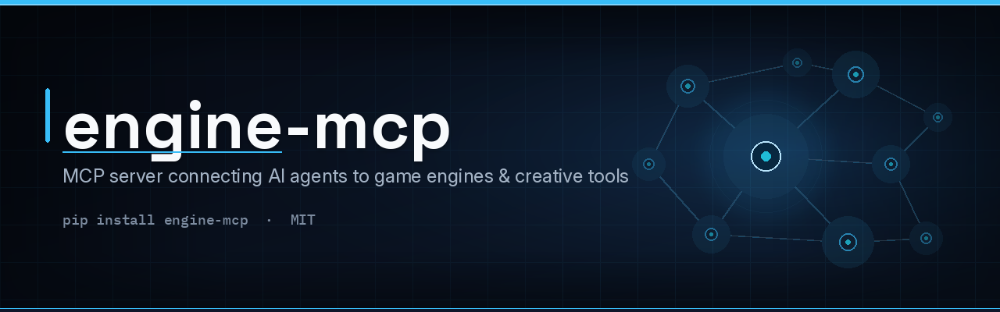
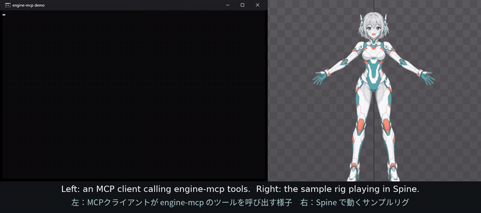
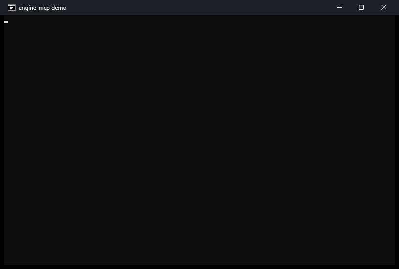
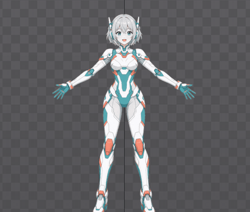
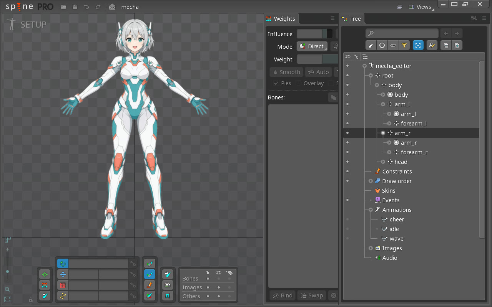
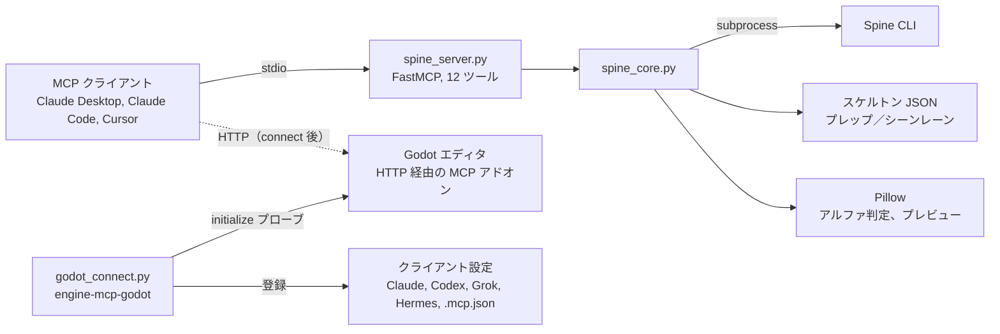

# engine-mcp

[English](https://github.com/kurtstaines/engine-mcp/blob/main/README.md) | 日本語



[](https://github.com/kurtstaines/engine-mcp/actions/workflows/ci.yml)
[](https://github.com/kurtstaines/engine-mcp/blob/main/LICENSE)


**AI エージェントに Spine 2D アニメーションエディタを操作させ、Godot の MCP エンドポイントをコマンド一つであらゆる AI クライアントに接続します。**



ゲームエンジンのツールは、マウスを握る人の手を前提に作られています。`engine-mcp` はそれらを [Model Context Protocol](https://modelcontextprotocol.io)（MCP）経由で公開し、エージェント自身がスケルタルアニメーション素材のエクスポート、インポート、パック、修復、合成を行えるようにします。結果は大量のコンソール出力ではなく構造化データで返るため、エージェントはそれを見て次の処理を判断できます。



*サーバーに対する実際のクライアントセッション：接続、ツール一覧、2 体のキャラクターを 1 つのシーンに合成、Spine プロジェクトへのインポート。*

ステータス：**v0.1（初期版）。** あえて小さく作っています。

## 機能

- **Spine MCP サーバー**：stdio 経由の 12 ツール。Claude Desktop、Claude Code、Cursor、Codex CLI など、あらゆる MCP クライアントから使えます。
- **エディタレーン**：Spine 公式のコマンドラインインターフェースをラップします（エクスポート、インポート、テクスチャのパックとアンパック、アニメーションのクリーンアップ、エディタの起動）。
- **プレップレーン**：生成されたスケルトン JSON を、Spine 4.x のインポーターが受け付ける形に修復します。ウェイト付きメッシュをウェイトなしに、ばらばらのキーフレームを正しいタイムラインに、3.x 形式のベジェカーブを 4.x 形式に変換します。純粋な Python で、新しいファイルに書き出し、元ファイルには一切手を触れません。
- **シーンレーン**：リグ済みの複数キャラクターを、名前にプレフィックスを付け、メッシュのボーンインデックスを振り直したうえで 1 つのスケルトンに統合し、レイアウトのプレビュー PNG を出力します。純粋な Python です。
- **Godot コネクター**：Godot の MCP アドオンの HTTP エンドポイントを確認し、Claude Code、Codex、Grok、Hermes、およびプロジェクトの `.mcp.json` に登録する小さな CLI です。
- **統一された戻り値**：すべてのツールが `ok` フラグを含む dict を返します。

## クイックスタート

```bash
pip install engine-mcp
engine-mcp-spine --selftest
```

サンプルを動かす場合は、リポジトリをクローンして作業してください。

```bash
git clone https://github.com/kurtstaines/engine-mcp.git
cd engine-mcp
pip install -e .
python examples/compose_scene.py
```

`--selftest` は登録済みのツールを一覧表示し、Spine CLI が見つかったかどうかを報告します。サンプルは 2 体のキャラクターを 1 つのシーンに合成するもので、Spine のインストールは不要です。



*サンプルリグの `idle`、`wave`、`cheer` アニメーションを、Spine エディタで再生して録画したものです。*

### サンプルリグ

[examples/build_rig.py](https://github.com/kurtstaines/engine-mcp/blob/main/examples/build_rig.py) は、1 枚の平面キャラクター画像を Spine スケルトンに変換します。

- 背景を抜き、イラストを 6 つのパーツ（胴体、頭、上腕、前腕）に切り分けます
- 7 本のボーンとリージョンアタッチメントを持つ `examples/mecha.json` を書き出します
- 時間の関数として 3 つのアニメーションを生成します。各パーツが胴体から一拍遅れて追従するので、idle ループが上下に揺れるだけでなく、呼吸しているように見えます

切り分け線と関節の位置は、この 1 枚の画像のために手で選んだものです。これはサンプルであり、汎用の自動リガーではありません。元のイラストは Grok Imagine で生成しました。



*`spine_import` で Spine プロジェクトにインポートし、`spine_open_editor` で開いた `examples/mecha.json`：7 本のボーン、6 つの画像パーツ、3 つのアニメーション。*

動作要件：Python 3.10 以上。エディタレーンには、ライセンス済みの [Spine](https://esotericsoftware.com) のインストールも必要です。CLI が `C:\Program Files\Spine\Spine.com` にない場合は `SPINE_EXE` を設定してください。プレップ、シーン、画像の各ツールは Spine なしで動作します。

## MCP クライアントの接続

**Claude Code**

```bash
claude mcp add spine -- engine-mcp-spine
```

**Claude Desktop**（`claude_desktop_config.json`）、**Cursor**、またはプロジェクトの **`.mcp.json`**：

```json
{
  "mcpServers": {
    "spine": {
      "command": "engine-mcp-spine",
      "env": { "SPINE_EXE": "C:/Program Files/Spine/Spine.com" }
    }
  }
}
```

[uv](https://docs.astral.sh/uv/) が入っていれば、インストール手順を省いてクライアントにパッケージを取得させることもできます。`"command": "uvx"` と `"args": ["--from", "engine-mcp", "engine-mcp-spine"]` を設定してください。

クライアントが `PATH` 上で `engine-mcp-spine` を見つけられない場合（仮想環境にインストールしたときによく起こります）は、`command` にその環境の Python を指定し、`"args": ["-m", "engine_mcp.spine_server"]` を使ってください。この設定のコピーは [examples/mcp.json](https://github.com/kurtstaines/engine-mcp/blob/main/examples/mcp.json) にあります。

| 変数 | 用途 |
|---|---|
| `SPINE_EXE` | Spine CLI のパス。既定値は `C:\Program Files\Spine\Spine.com`。 |
| `SPINE_UPDATE` | 任意。すべての呼び出しでエディタのバージョンを固定します（例：`4.2.43`）。 |

## ツール

| ツール | 入力 | 内容 |
|---|---|---|
| `spine_version` | なし | 使用中の Spine のバージョンと CLI のパスを報告します。 |
| `spine_export` | `input_path`, `output_path`, `export="json"`, `clean=False`, `version=""` | プロジェクトまたはスケルトンデータをエクスポートします。`export` には `json`、`binary`、`json+pack`、`binary+pack`、またはエディタで保存したエクスポート設定 JSON のパスを指定します。 |
| `spine_import` | `data_path`, `project_path`, `name=""`, `scale=0.0`, `prep=True` | スケルトン JSON または `.skel` を `.spine` プロジェクトにインポートします。`prep` が false でない限り、JSON には先に `rig_editor_prep` を実行します。 |
| `spine_pack` | `images_dir`, `output_dir`, `name="atlas"`, `pack_settings=""`, `project=""` | 画像フォルダをテクスチャアトラスにパックします。 |
| `spine_unpack` | `atlas_path`, `images_dir`, `output_dir` | テクスチャアトラスを画像に戻します。 |
| `spine_clean` | `project_path`, `output_path=""` | Spine のアニメーションクリーンアップを実行します。 |
| `spine_open_editor` | `project_path=""` | Spine エディタを開きます（プロジェクト指定は任意）。処理はブロックしません。ランチャーで「Start automatically」にチェックが入っていない限り、Spine はまずランチャーを表示して **Start** を待ちます。MCP クライアントが切断するとエディタは閉じます。 |
| `rig_editor_prep` | `rig_json`, `output=""` | スケルトン JSON をエディタのインポーター向けに修復し、`<stem>_editor.json` に書き出します。 |
| `analyze_alpha` | `image` | 透明、不透明、半透明の割合と、画像がすでに背景抜き済みかどうかを報告します。 |
| `scene_compose` | `characters`, `output_json`, `scene_name="scene"` | キャラクターを 1 つのスケルトンに統合します。各キャラクターは `{"json", "prefix", "x", "y", "scale", "rotation"}` で指定します。 |
| `scene_preview` | `characters`, `output_png`, `width=1920`, `height=1080` | 各キャラクターのテクスチャを配置位置に合成し、レイアウト PNG を出力します。 |
| `scene_to_project` | `scene_json`, `project_path`, `scale=0.0` | 合成したシーンを `.spine` プロジェクトにインポートします。 |

### Godot コネクター

起動中のエディタから HTTP を提供する MCP アドオン入りの Godot プロジェクトが必要です。既定値はエンドポイント `http://127.0.0.1:8000/mcp`、アドオンフォルダ `addons/godot_ai`、サーバー名 `godot-ai` です。`--url`、`--addon`、`--name` で変更できます。

```bash
engine-mcp-godot --project path/to/godot_project doctor
engine-mcp-godot verify
engine-mcp-godot --clients claude,codex connect
```

| コマンド | 内容 |
|---|---|
| `status` | エンドポイントのポートが開いているかと、登録済みのクライアントを表示します。 |
| `doctor` | アドオンのインストール、エンドポイントの稼働、クライアントの登録を、3 つの別々の事実として報告します。それぞれ失敗する原因が違うためです。 |
| `verify` | 実際に MCP の `initialize` リクエストを送り、応答を報告します。 |
| `connect` | エンドポイントを `claude`、`codex`、`grok`、`hermes`、`project`（`.mcp.json`）のいずれかまたは複数に登録します。 |

## アーキテクチャ



サーバーは薄いレイヤーです。各ツールは `spine_core` への 1 回の呼び出しで、`spine_core` はスクリプトから直接インポートして使うこともできます（[examples/compose_scene.py](https://github.com/kurtstaines/engine-mcp/blob/main/examples/compose_scene.py) を参照）。

## テスト

```bash
pip install -e ".[dev]"
pytest
```

24 個のテストで、合成リグを使ったプレップ、シーン、画像の各レーンのエンドツーエンド動作、MCP ツールの登録とツール呼び出しの往復、ローカルの代替 HTTP エンドポイントに対する Godot コネクターを検証しています。エディタレーンは Spine CLI に渡す引数のレベルでテストしています。CI には Spine がインストールされていないため、CLI 自体はそこでは実行されません。`claude` と `codex` の CLI 経由での登録はテスト対象外です。

## ロードマップ

- MCP クライアントを持たないエージェント向けの、Spine ツールのコマンドライン入口
- エンジンレジストリとステータスサーバー（どのエンジンアダプタがインストール済みで稼働中か）
- ボーンマーカーツール：イラストにマーカーを描き、リグのプリセットとして保存
- 自動リギングレーン（画像からリグ済みスケルトンへ）
- MCP で動かす Godot 向け 3D アニメーションワークフロー

## コントリビュート

Issue とプルリクエストを歓迎します。PR を出す前に、次を実行してください。

```bash
ruff check . && ruff format --check . && pytest
```

ツールは `{"ok": bool, ...}` の戻り値の形を守り、Spine エディタなしで動くものにはテストを追加してください。

## ライセンス

MIT。[LICENSE](https://github.com/kurtstaines/engine-mcp/blob/main/LICENSE) を参照してください。

---

*この日本語版は英語版 README の翻訳です。内容に差異がある場合は英語版を優先します。*
