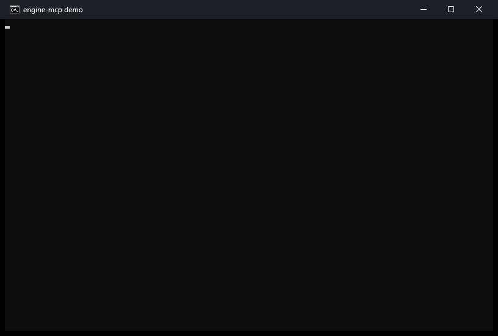
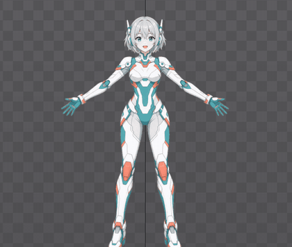
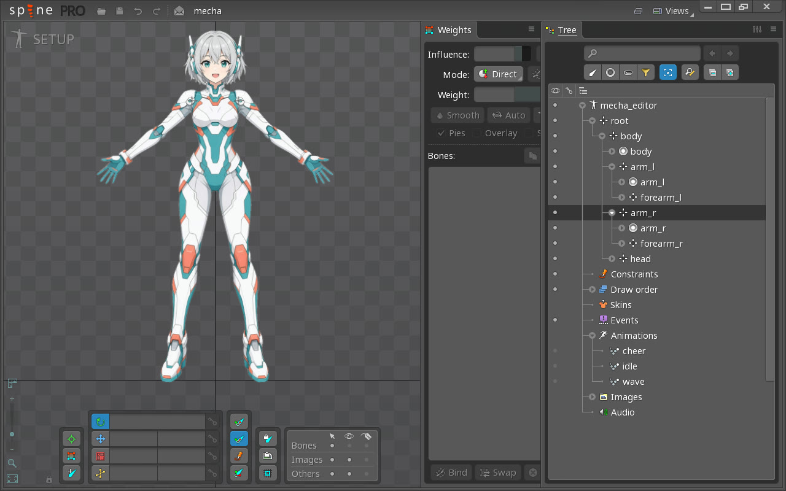
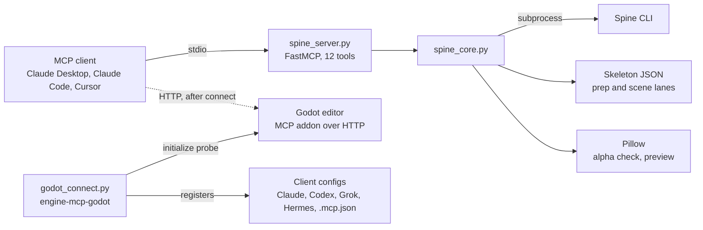

# engine-mcp

[](https://github.com/kurtstaines/engine-mcp/actions/workflows/ci.yml)
[](https://github.com/kurtstaines/engine-mcp/blob/main/LICENSE)


**Let an AI agent drive the Spine 2D animation editor, and plug a Godot MCP endpoint into every AI client with one command.**

Game-engine tools are built for hands on a mouse. `engine-mcp` exposes them over the [Model Context Protocol](https://modelcontextprotocol.io) so an agent can export, import, pack, repair and compose skeletal animation assets itself, and get back a structured result it can branch on instead of a wall of console text.



*A real client session against the server: connect, list tools, compose two characters into one scene, import it into a Spine project.*

Status: **v0.1, early.** Small on purpose.

## Features

- **Spine MCP server**: 12 tools over stdio, usable from Claude Desktop, Claude Code, Cursor, Codex CLI or any other MCP client.
- **Editor lane**: wraps the official Spine command-line interface (export, import, texture pack and unpack, animation clean-up, open the editor).
- **Prep lane**: repairs generated skeleton JSON so the Spine 4.x importer accepts it. Converts weighted meshes to unweighted, loose keyframe lists to proper timelines, and 3.x Bezier curves to 4.x form. Pure Python, writes a new file, never touches the source.
- **Scene lane**: merges several rigged characters into one skeleton with prefixed names and re-based mesh bone indices, and renders a layout preview PNG. Pure Python.
- **Godot connector**: a small CLI that checks a Godot MCP addon's HTTP endpoint and registers it with Claude Code, Codex, Grok, Hermes and a project `.mcp.json`.
- **One result contract**: every tool returns a dict with an `ok` flag.

## Quickstart

```bash
pip install engine-mcp
engine-mcp-spine --selftest
```

To run the examples, work from a clone instead:

```bash
git clone https://github.com/kurtstaines/engine-mcp.git
cd engine-mcp
pip install -e .
python examples/compose_scene.py
```

`--selftest` lists the registered tools and reports whether the Spine CLI was found. The example composes two characters into one scene with no Spine install needed.



*The sample rig's `idle`, `wave` and `cheer` animations, recorded playing in the Spine editor.*

### The sample rig

[examples/build_rig.py](https://github.com/kurtstaines/engine-mcp/blob/main/examples/build_rig.py) turns one flat character image into a Spine skeleton:

- keys out the background and cuts the art into six parts (body, head, upper arms, forearms)
- writes `examples/mecha.json` with seven bones and region attachments
- generates three animations as functions of time, with each part trailing the body a beat late so the idle loop breathes instead of bobbing

The cut lines and joint positions are hand-picked for this one image; it is an example, not a general auto-rigger. The source art was generated with Grok Imagine.



*`examples/mecha.json` imported into a Spine project with `spine_import` and opened with `spine_open_editor`: seven bones, six image parts and three animations.*

Requirements: Python 3.10+. The editor lane also needs a licensed [Spine](https://esotericsoftware.com) install; set `SPINE_EXE` if the CLI is not at `C:\Program Files\Spine\Spine.com`. The prep, scene and image tools work without it.

## Connect an MCP client

**Claude Code**

```bash
claude mcp add spine -- engine-mcp-spine
```

**Claude Desktop** (`claude_desktop_config.json`), **Cursor**, or a project **`.mcp.json`**:

```json
{
  "mcpServers": {
    "spine": {
      "command": "engine-mcp-spine",
      "env": { "SPINE_EXE": "C:/Program Files/Spine/Spine.com" }
    }
  }
}
```

With [uv](https://docs.astral.sh/uv/) installed you can skip the install step and let the client fetch the package: set `"command": "uvx"` and `"args": ["--from", "engine-mcp", "engine-mcp-spine"]`.

If the client cannot find `engine-mcp-spine` on its `PATH` (common when you installed into a virtual environment), point `command` at that environment's Python and use `"args": ["-m", "engine_mcp.spine_server"]`. A copy of this config lives in [examples/mcp.json](https://github.com/kurtstaines/engine-mcp/blob/main/examples/mcp.json).

| Variable | Purpose |
|---|---|
| `SPINE_EXE` | Path to the Spine CLI. Default `C:\Program Files\Spine\Spine.com`. |
| `SPINE_UPDATE` | Optional. Pins the editor version for every call, for example `4.2.43`. |

## Tools

| Tool | Inputs | What it does |
|---|---|---|
| `spine_version` | none | Reports the Spine version and the CLI path in use. |
| `spine_export` | `input_path`, `output_path`, `export="json"`, `clean=False`, `version=""` | Exports a project or skeleton data. `export` is `json`, `binary`, `json+pack`, `binary+pack`, or a path to an export-settings JSON saved from the editor. |
| `spine_import` | `data_path`, `project_path`, `name=""`, `scale=0.0`, `prep=True` | Imports skeleton JSON or `.skel` into a `.spine` project. Runs `rig_editor_prep` on JSON first unless `prep` is false. |
| `spine_pack` | `images_dir`, `output_dir`, `name="atlas"`, `pack_settings=""`, `project=""` | Packs a folder of images into a texture atlas. |
| `spine_unpack` | `atlas_path`, `images_dir`, `output_dir` | Unpacks a texture atlas back into images. |
| `spine_clean` | `project_path`, `output_path=""` | Runs Spine's animation clean-up. |
| `spine_open_editor` | `project_path=""` | Opens the Spine editor, optionally with a project. Does not block. Spine shows its launcher first and waits for **Start** unless "Start automatically" is ticked there. The editor closes when the MCP client disconnects. |
| `rig_editor_prep` | `rig_json`, `output=""` | Repairs skeleton JSON for the editor importer. Writes `<stem>_editor.json`. |
| `analyze_alpha` | `image` | Reports transparent, opaque and partial alpha percentages and whether the image is already keyed. |
| `scene_compose` | `characters`, `output_json`, `scene_name="scene"` | Merges characters into one skeleton. Each character is `{"json", "prefix", "x", "y", "scale", "rotation"}`. |
| `scene_preview` | `characters`, `output_png`, `width=1920`, `height=1080` | Composites each character's texture at its placement into a layout PNG. |
| `scene_to_project` | `scene_json`, `project_path`, `scale=0.0` | Imports a composed scene into a `.spine` project. |

### Godot connector

Needs a Godot project with an MCP addon that serves HTTP from the running editor. Defaults: endpoint `http://127.0.0.1:8000/mcp`, addon folder `addons/godot_ai`, server name `godot-ai`; override with `--url`, `--addon`, `--name`.

```bash
engine-mcp-godot --project path/to/godot_project doctor
engine-mcp-godot verify
engine-mcp-godot --clients claude,codex connect
```

| Command | What it does |
|---|---|
| `status` | Shows whether the endpoint port is open and which clients are registered. |
| `doctor` | Reports addon install, endpoint liveness and client registration as three separate facts, because each fails for a different reason. |
| `verify` | Sends a real MCP `initialize` request and reports the response. |
| `connect` | Registers the endpoint with `claude`, `codex`, `grok`, `hermes` and/or `project` (`.mcp.json`). |

## Architecture



The server is a thin layer: each tool is one call into `spine_core`, which you can also import directly from a script (see [examples/compose_scene.py](https://github.com/kurtstaines/engine-mcp/blob/main/examples/compose_scene.py)).

## Tests

```bash
pip install -e ".[dev]"
pytest
```

24 tests cover the prep, scene and image lanes end to end on a synthetic rig, the MCP tool registration and a tool call round trip, and the Godot connector against a local stand-in HTTP endpoint. The editor lane is tested at the level of the arguments it passes to the Spine CLI; CI does not have Spine installed, so the CLI itself is not exercised there. Registration through the `claude` and `codex` CLIs is not covered.

## Roadmap

- Command-line front door for the Spine tools, for agents without an MCP client
- Engine registry and status server (which engine adapters are installed and live)
- Bone-marker tool: draw markers on art and save them as rig presets
- Automatic rigging lane (image to rigged skeleton)
- 3D animation workflow for Godot driven through MCP

## Contributing

Issues and pull requests are welcome. Before opening a PR:

```bash
ruff check . && ruff format --check . && pytest
```

Keep tools returning the `{"ok": bool, ...}` contract, and add a test for anything that does not need the Spine editor to run.

## License

MIT. See [LICENSE](https://github.com/kurtstaines/engine-mcp/blob/main/LICENSE).
